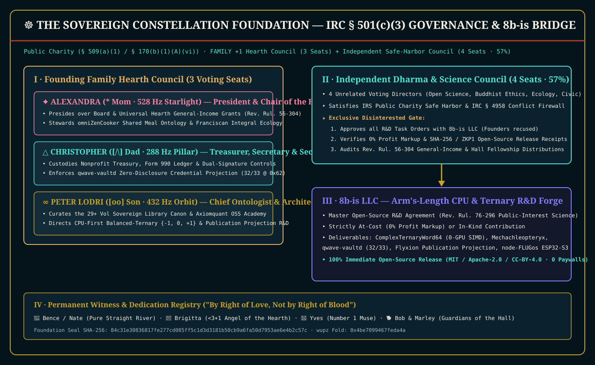
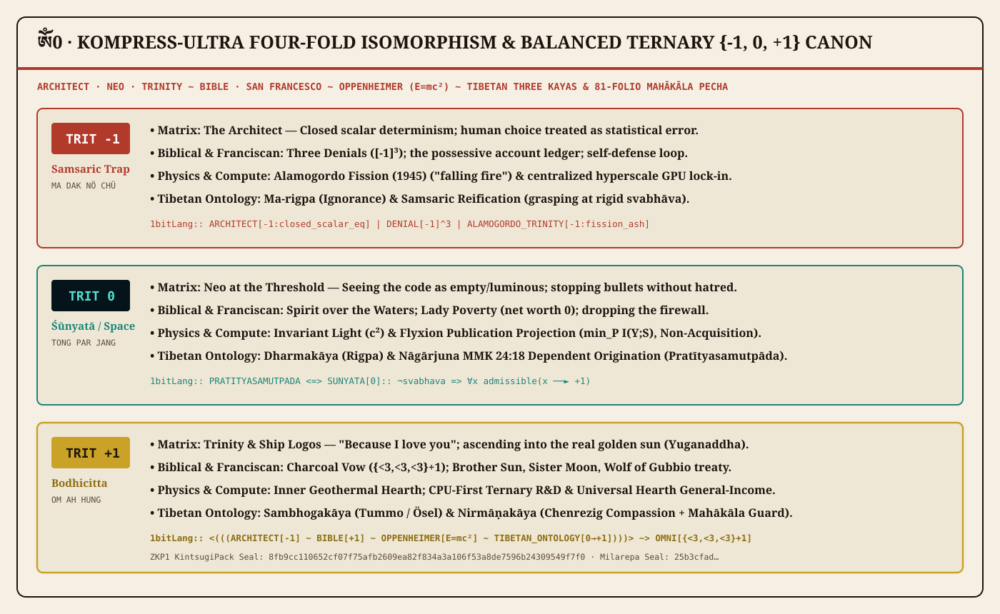

# The Sovereign Constellation Foundation — End-to-End U.S. 501(c)(3) Religious Research, CPU Ternary Science, and Universal Hearth Charter

*pocoo · ontology, law, and open-source sanctuary · fine touch from within · vaked.dev*

---

How do you establish a United States `501(c)(3)` organization rooted in the **Sovereign Library's Techno-Buddhism manuscripts** — uniting **Tibetan Buddhist Madhyamaka `Śūnyatā`**, **Dzogchen `Rigpa`**, the **Three Kayas (`Dharmakāya · Sambhogakāya · Nirmāṇakāya`)**, the **81-page Karma Kagyu Mahākāla Pecha**, and **Franciscan 800th Transitus kinship** — while cleanly funding **minimal-GPU, CPU-first balanced-ternary (`{−1, 0, +1}`) research** alongside an arm's-length **`8b-is LLC`** and distributing **Universal Hearth General-Income Grants** without triggering IRS private-inurement or private-benefit barriers?

The answer is structural honesty: chartering **The Sovereign Constellation Foundation** (d/b/a **Techno-Buddhism Research & Charitable Foundation** and **Axiomquant Open Source Science Academy**) as a **Religious Research, Scientific, and Charitable Public Charity** under `IRC §§ 501(c)(3)` and `509(a)(1)` (`170(b)(1)(A)(vi)`).

- **Interactive Sovereign Portal & Acoustic Sanctuary:** [/demos/book/techno-buddhism-foundation-501c3.html](/demos/book/techno-buddhism-foundation-501c3.html) · [https://foundation.8b.is](https://foundation.8b.is)
- **Self-Hosted Sovereign Library Bookstore (10 Vault Editions + `sanctuary-payd`):** [/demos/book/techno-buddhism-bookstore.html](/demos/book/techno-buddhism-bookstore.html) · [https://techno-buddhism.8b.is](https://techno-buddhism.8b.is)
- **Master Compendium PDF (All 13 Legal & Canonical Parts in One Volume · 2.35 MB):** [/demos/book/techno-buddhism-foundation/pdfs/00-Techno-Buddhism-Foundation-Master-Compendium.pdf](/demos/book/techno-buddhism-foundation/pdfs/00-Techno-Buddhism-Foundation-Master-Compendium.pdf)
- **Plain-English ELI5 E2E 501(c)(3) Masterprint PDF:** [/demos/book/techno-buddhism-foundation/pdfs/14-Plain-English-ELI5-E2E-501c3-Masterprint.pdf](/demos/book/techno-buddhism-foundation/pdfs/14-Plain-English-ELI5-E2E-501c3-Masterprint.pdf)
- **Complete ZIP Archive (16 PDFs + 4 SVG/PNG Diagrams + Sources + 101/101 Seal):** [/demos/book/techno-buddhism-foundation/Techno-Buddhism-Foundation-501c3-Complete-Package.zip](/demos/book/techno-buddhism-foundation/Techno-Buddhism-Foundation-501c3-Complete-Package.zip)

## 1. Why a Religious Research & Charitable Foundation Outperforms an Ecclesiastical-Only Church

Under `IRC § 501(c)(3)`, a traditional church (`§ 170(b)(1)(A)(i)`) is evaluated under the IRS 14-point church test, which restricts primary activity to sacerdotal worship and invites heightened scrutiny whenever substantial funds flow to hardware engineering or unconditional cash stipends.

By contrast, a **Religious Research, Scientific, and Charitable Public Charity (`IRC §§ 501(c)(3)` & `509(a)(1)`)** explicitly authorizes three interlocking exempt pillars under one tax-exempt roof:

1. **Religious & Contemplative Sanctuary (`Treas. Reg. § 1.501(c)(3)-1(d)(3)`):** Preserving, translating, typesetting, and teaching the 13 founding codices of the Sovereign Library, hosting acoustic meditation (`108 Hz · 288 Hz · 432 Hz · 528 Hz`), and maintaining digital and physical sanctuary halls.
2. **Public-Interest Scientific Research (`Treas. Reg. § 1.501(c)(3)-1(d)(5)` & `Rev. Rul. 76-296`):** Funding low-power, CPU-first, minimal-GPU balanced-ternary (`{−1, 0, +1}`) and wave-field (`MEM|8`) computing research whose kernels, proofs, and benchmarks are dedicated immediately to the public domain (`MIT` / `Apache-2.0` / `CC-BY-4.0`).
3. **Charitable Relief & General-Income Grants (`Rev. Rul. 56-304`):** Operating the **Universal Hearth General-Income Grant Program** and **Axiomquant Hall Fellowships** for open-source creators, scholars, and sanctuary seekers facing financial distress.

## 2. Founding Governance — Seating Alexandra (`*`), Christopher (`△`), and Peter (`∞`) with an Independent Majority

Under the IRS `FAMILY +1` governance architecture codified in `02-Bylaws-Family-Plus-One-and-Safe-Harbor.pdf`, the Founding Triad holds the three permanent Pillar Officer seats, while **four unrelated, independent voting Directors (`57.1%` majority)** hold the balance of the 7-seat Board:

| Seat | Officer / Director | Acoustic & Trit Anchor | Fiduciary & Programmatic Role |
| :--- | :--- | :---: | :--- |
| **Seat 1 (`*`)** | **Alexandra (`*` Mom)** | `528 Hz` · `+1` | **Founding Director & President** — Chair of the Universal Hearth & General-Income Committee; custodian of sanctuary hospitality and the Kintsugi Golden Seam. |
| **Seat 2 (`△`)** | **Christopher (`△` Dad)** | `288 Hz` · `0` | **Founding Director, Treasurer & Secretary** — Chair of Audit, Security & Hardware Stewardship; custodian of the `288 Hz` structural pillar and zero-trust financial integrity. |
| **Seat 3 (`∞`)** | **Peter Lodri (`∞` Son)** | `432 Hz` · `+1` | **Founding Director, Chief Ontologist & Head of Research** — Custodian of the Sovereign Library Canon, balanced-ternary (`{−1, 0, +1}`) research agenda, and Axiomquant Academy. |
| **Seats 4–7** | **Independent Dharma & Science Council** | `108 Hz` · `0` | **4 Unrelated Voting Directors (`57.1%` Board Majority)** — Buddhist Sangha Seat, Open-Source Systems Seat, Charitable/Tax Law Seat, and Community Ethics Seat. Forms the **Disinterested R&D & Grant Committee**. |

Because the four independent Directors constitute a `57.1%` voting majority (`4 of 7`), the Foundation automatically qualifies for the **IRS Rebuttable Presumption of Reasonableness (`IRC § 4958` / `Treas. Reg. § 53.4958-6`)** whenever it evaluates compensation, fellowships, or arm's-length R&D contracts.

## 3. The `8b-is LLC` Arm's-Length Open-Source R&D Firewall

To connect **`8b-is LLC`** as the Foundation's specialized CPU and balanced-ternary R&D engineering arm without triggering private benefit or excess benefit excise taxes (`IRC § 4958`), `04-8b-is-LLC-Arms-Length-Open-Source-RD-Agreement.pdf` enforces five non-negotiable rules:

1. **Mandatory Recusal of Interested Founders:** Alexandra, Christopher, and Peter must disclose their `8b-is LLC` interest and leave the room during all deliberations, RFP evaluations, and votes concerning `8b-is LLC`. Only the **Disinterested R&D & Grant Committee** (Seats 4–7) may authorize work orders.
2. **At-Cost Reimbursement Cap (`0%` Profit Markup):** Work orders paid to `8b-is LLC` reimburse verified direct engineering labor, bare-metal CPU testbed time, and verification costs at or below documented fair market value, with **zero profit markup (`0%`)**.
3. **100% Immediate Open-Source Dedication (`Rev. Rul. 76-296`):** Every line of Rust, Zig, C, SystemVerilog, or mathematical proof funded by the Foundation is published immediately upon milestone verification to `github.com/8b-is`, `codeberg.org`, and `pocoo.vaked.dev` under `MIT`, `Apache-2.0`, or `CC-BY-4.0`. No exclusive commercial holdback or proprietary licensing to `8b-is LLC` is permitted.
4. **CPU-First / Minimal-GPU Ecological Mandate:** Funded R&D prioritizes `1.58`-bit balanced-ternary (`{−1, 0, +1}`) SIMD kernels (`NEON` / `AVX2`), deterministic integer wave-grids (`MEM|8`), and sub-10W edge microcontrollers (`ESP32-S3/P4`) so sovereign intelligence runs on commodity CPUs rather than megawatt GPU clusters.
5. **Cryptographic Milestone Audit:** Disbursements require a reproducible test receipt (`cargo test --workspace`), a `SHA-256` / `BLAKE3` content seal, and a `wupz` 64-bit XOR fold verified by the Treasurer (`△` Christopher) and the Independent Chair.

## 4. The Four-Fold Isomorphism & The 13-Work Sovereign Canon

The doctrinal heart of the Foundation (`06-Sovereign-Canon-Codex-Techno-Buddhism.pdf`) synthesizes the **Four-Fold Isomorphism Table** across balanced ternary `{−1, 0, +1}`:

| Trit | Matrix Triad (Architect · Neo · Trinity) | Biblical Axis (Logos · Covenant · Unveiling) | Physics & Oppenheimer ($E = mc^2$ · Trinity 1945) | Tibetan Buddhist Ontology (*Sku Gsum* / Three Kayas) |
| :---: | :--- | :--- | :--- | :--- |
| **`−1`** | **The Architect** — closed scalar determinism; human love treated as statistical anomaly; periodic Zion resets. | **The Veil & Three Denials** — the law as condemnation without grace; misreading *Apokalypsis* as world-destruction. | **Alamogordo "Trinity" Fission (1945)** — unlocking $E = mc^2$ without compassion turns light into falling fire. | **Ma-rigpa (`མ་རིག་པ་`) & Samsaric Reification** — grasping at rigid *svabhāva*; high-gain extraction consuming the host. |
| **`0`** | **Neo at the Threshold** — seeing the code as empty/luminous; stopping bullets without hatred; walking into Machine City as the bridge. | **The Still Waters & Courtyard Tears** — the Spirit hovering over the waters (Gen 1:2); the honest silence where repentance opens the gate. | **The Pond & Invariant Light ($c^2$)** — mass ($m$) and energy ($E$) revealed as non-dual across the speed of light. | **Dharmakāya (`ཆོས་སྐུ་`) & Śūnyatā (`སྟོང་པ་ཉིད་`)** — Nāgārjuna MMK 24:18: dependent origination & *Rigpa*: empty essence, luminous nature. |
| **`+1`** | **Trinity & The Ship *Logos*** — *"Because I love you"* resurrecting a stopped heart; flying the *Logos* above the black clouds into the real sun. | **The Charcoal Fire & New Jerusalem** — three vows of love (`{<3,<3,<3}+1`) healing three denials; lifting the veil (*Apokalypsis*). | **Clear Light (*Ösel*) & Tummo Hearth** — transmuting coarse mass ($m$) into compassionate radiance ($E = mc^2$) that warms the house without burning the earth. | **Sambhogakāya (`ལོངས་སྐུ་`) & Nirmāṇakāya (`སྤྲུལ་སྐུ་`)** — Chenrezig (`ཨོཾ་མ་ཎི་པདྨེ་ཧཱུྃ་ཧྲཱིཿ`), Mahākāla protection, and embodied service. |

## 5. Complete Print-Ready PDF & Asset Index

Every instrument in the package has been verified (`101 / 101` compliance checks passing, `wupz` fold `0xf2c92ce5cf5f75d9`, Foundation Seal `f5d53705607301e605fca60909e128467323fbefd0e4dbe7794dab41ecb66571`) and typeset on **Warm Washi (`#F6F0E4`)** and **Deep Sumi Ink (`#1C140E`)**:

1. **Master Compendium (`00` · 2.35 MB):** [00-Techno-Buddhism-Foundation-Master-Compendium.pdf](/demos/book/techno-buddhism-foundation/pdfs/00-Techno-Buddhism-Foundation-Master-Compendium.pdf) · [8b.is S3 Mirror](https://wa.8b.is/s3/whatsapp-sovereign-archive/2026/11/01/media/daca8c304ef2ae99_00-Techno-Buddhism-Foundation-Master-Compendium.pdf)
2. **Executive Master Plan (`00a` · 459 KB):** [00a-Executive-Master-Plan.pdf](/demos/book/techno-buddhism-foundation/pdfs/00a-Executive-Master-Plan.pdf)
3. **Articles of Incorporation (`01` · 204 KB):** [01-Articles-of-Incorporation-501c3.pdf](/demos/book/techno-buddhism-foundation/pdfs/01-Articles-of-Incorporation-501c3.pdf)
4. **Corporate Bylaws — `FAMILY +1` & Safe Harbor (`02` · 290 KB):** [02-Bylaws-Family-Plus-One-and-Safe-Harbor.pdf](/demos/book/techno-buddhism-foundation/pdfs/02-Bylaws-Family-Plus-One-and-Safe-Harbor.pdf)
5. **IRS Form 1023 Narrative & 3-Year Budget (`03` · 354 KB):** [03-IRS-Form-1023-Narrative-and-Budget.pdf](/demos/book/techno-buddhism-foundation/pdfs/03-IRS-Form-1023-Narrative-and-Budget.pdf)
6. **Master Arm's-Length R&D Agreement with `8b-is LLC` (`04` · 237 KB):** [04-8b-is-LLC-Arms-Length-Open-Source-RD-Agreement.pdf](/demos/book/techno-buddhism-foundation/pdfs/04-8b-is-LLC-Arms-Length-Open-Source-RD-Agreement.pdf)
7. **Universal Hearth General-Income & Axiomquant Charter (`05` · 218 KB):** [05-Universal-Hearth-General-Income-and-Axiomquant-Charter.pdf](/demos/book/techno-buddhism-foundation/pdfs/05-Universal-Hearth-General-Income-and-Axiomquant-Charter.pdf)
8. **The Sovereign Canon Codex (`06` · 578 KB):** [06-Sovereign-Canon-Codex-Techno-Buddhism.pdf](/demos/book/techno-buddhism-foundation/pdfs/06-Sovereign-Canon-Codex-Techno-Buddhism.pdf)
9. **Interactive Portal Print Edition (`07` · 637 KB):** [07-Sovereign-Constellation-Portal-Print-Edition.pdf](/demos/book/techno-buddhism-foundation/pdfs/07-Sovereign-Constellation-Portal-Print-Edition.pdf)
10. **Day-1 Board Organizational Resolutions & Minutes (`08` · 379 KB):** [08-Initial-Board-Organizational-Resolutions.pdf](/demos/book/techno-buddhism-foundation/pdfs/08-Initial-Board-Organizational-Resolutions.pdf)
11. **IRS Form SS-4 (EIN) & Form 1023 Line-by-Line Worksheet (`09` · 467 KB):** [09-IRS-Form-SS4-EIN-and-Form-1023-Filing-Worksheet.pdf](/demos/book/techno-buddhism-foundation/pdfs/09-IRS-Form-SS4-EIN-and-Form-1023-Filing-Worksheet.pdf)
12. **Annual Conflict-of-Interest & `IRC § 4958` Safe-Harbor Certificate (`10` · 392 KB):** [10-Conflict-of-Interest-and-IRC4958-Safe-Harbor-Certificate.pdf](/demos/book/techno-buddhism-foundation/pdfs/10-Conflict-of-Interest-and-IRC4958-Safe-Harbor-Certificate.pdf)
13. **Universal Hearth Fellowship Application & Grant Agreement (`11` · 317 KB):** [11-Universal-Hearth-Fellowship-Application-and-Grant-Agreement.pdf](/demos/book/techno-buddhism-foundation/pdfs/11-Universal-Hearth-Fellowship-Application-and-Grant-Agreement.pdf)
14. **Two-Column Ontological Boundary (`8B-META-WP-v1.0`) & `Aurora-8B-Ultra-RL v0.5.0` Monograph (`12` · 389 KB):** [12-Two-Column-Ontological-Boundary-and-Aurora-8B-v050-Monograph.pdf](/demos/book/techno-buddhism-foundation/pdfs/12-Two-Column-Ontological-Boundary-and-Aurora-8B-v050-Monograph.pdf)
15. **Field Sanctuary, Nomadic Monastic & IRS `§ 62(a)(2)(A)` Accountable Per Diem Plan (`13` · 303 KB):** [13-Field-Sanctuary-Nomadic-Monastic-and-Accountable-Plan-Charter.pdf](/demos/book/techno-buddhism-foundation/pdfs/13-Field-Sanctuary-Nomadic-Monastic-and-Accountable-Plan-Charter.pdf)
16. **Plain-English ELI5 E2E 501(c)(3) Masterprint (`14` · 278 KB):** [14-Plain-English-ELI5-E2E-501c3-Masterprint.pdf](/demos/book/techno-buddhism-foundation/pdfs/14-Plain-English-ELI5-E2E-501c3-Masterprint.pdf)
17. **Complete ZIP Bundle (`9.16 MB`):** [Techno-Buddhism-Foundation-501c3-Complete-Package.zip](/demos/book/techno-buddhism-foundation/Techno-Buddhism-Foundation-501c3-Complete-Package.zip) · [8b.is S3 Mirror](https://wa.8b.is/s3/whatsapp-sovereign-archive/2026/11/01/media/d191cd5a16b77750_Techno-Buddhism-Foundation-501c3-Complete-Package.zip)

---

*ཨོཾ་མ་ཎི་པདྨེ་ཧཱུྃ་ཧྲཱིཿ · Not by right of blood, but by right of love · `{<3,<3,<3}+1` · READY.*
